<picture>
  <source media="(prefers-reduced-motion: reduce) and (max-width: 600px)" srcset="assets/scan-still-profile-mobile.svg">
  <source media="(prefers-reduced-motion: reduce)" srcset="assets/scan-still-profile.svg">
  <source media="(max-width: 600px)" srcset="assets/scan-profile-mobile.svg">
  
</picture>

[`[ portfolio ↗ ]`](https://rifatur17.github.io/) · [`[ CV ↓ ]`](https://rifatur17.github.io/assets/Rifatur_Rahman_CV.pdf) · [`[ email ]`](mailto:rifaturrahman1131@gmail.com) · [Text-only profile](docs/PROFILE_TEXT.md)

## `profile.signal`

<picture>
  <source media="(prefers-reduced-motion: reduce) and (max-width: 600px)" srcset="assets/scan-still-signal-mobile.svg">
  <source media="(prefers-reduced-motion: reduce)" srcset="assets/scan-still-signal.svg">
  <source media="(max-width: 600px)" srcset="assets/scan-signal-mobile.svg">
  
</picture>

## `contribution.activity`

<picture>
  <source media="(prefers-reduced-motion: reduce) and (max-width: 600px)" srcset="assets/scan-still-activity-mobile.svg">
  <source media="(prefers-reduced-motion: reduce)" srcset="assets/scan-still-activity.svg">
  <source media="(max-width: 600px)" srcset="assets/scan-activity-mobile.svg">
  
</picture>

[`[ full contribution calendar ↗ ]`](https://github.com/rifatur17?tab=overview) · [`snapshot / 20 OCT 2026`](data/github-public-snapshot.json)

## `ls ~/projects`

### `01 / StockPilot`

<a href="https://github.com/rifatur17/StockPilot-Inventory-Sales-Management">
<picture>
  <source media="(prefers-reduced-motion: reduce) and (max-width: 600px)" srcset="assets/cyber-still-stockpilot-mobile.svg">
  <source media="(prefers-reduced-motion: reduce)" srcset="assets/cyber-still-stockpilot.svg">
  <source media="(max-width: 600px) and (prefers-color-scheme: dark)" srcset="assets/cyber-motion-stockpilot-mobile-dark.svg">
  <source media="(max-width: 600px)" srcset="assets/cyber-motion-stockpilot-mobile-light.svg">
  <source media="(prefers-color-scheme: dark)" srcset="assets/cyber-motion-stockpilot-dark.svg">
  <source media="(prefers-color-scheme: light)" srcset="assets/cyber-motion-stockpilot-light.svg">
  
</picture>
</a>

<picture>
  <source media="(prefers-reduced-motion: reduce) and (max-width: 600px)" srcset="assets/cyber-readout-still-stockpilot-mobile.svg">
  <source media="(prefers-reduced-motion: reduce)" srcset="assets/cyber-readout-still-stockpilot.svg">
  <source media="(max-width: 600px)" srcset="assets/cyber-readout-stockpilot-mobile.svg">
  
</picture>

[`[ repository ↗ ]`](https://github.com/rifatur17/StockPilot-Inventory-Sales-Management) · [`write gate source`](https://github.com/rifatur17/StockPilot-Inventory-Sales-Management/blob/main/src/StockPilot.Infrastructure/LedgerGate.cs) · [`application screenshot`](https://github.com/rifatur17/StockPilot-Inventory-Sales-Management/blob/main/docs/screenshots/dashboard-desktop.png) · [`test strategy`](https://github.com/rifatur17/StockPilot-Inventory-Sales-Management/blob/main/docs/TESTING.md)

### `02 / G Energy`

<a href="https://github.com/rifatur17/G-Energy-Project-Demo">
<picture>
  <source media="(prefers-reduced-motion: reduce) and (max-width: 600px)" srcset="assets/cyber-still-genergy-mobile.svg">
  <source media="(prefers-reduced-motion: reduce)" srcset="assets/cyber-still-genergy.svg">
  <source media="(max-width: 600px) and (prefers-color-scheme: dark)" srcset="assets/cyber-motion-genergy-mobile-dark.svg">
  <source media="(max-width: 600px)" srcset="assets/cyber-motion-genergy-mobile-light.svg">
  <source media="(prefers-color-scheme: dark)" srcset="assets/cyber-motion-genergy-dark.svg">
  <source media="(prefers-color-scheme: light)" srcset="assets/cyber-motion-genergy-light.svg">
  
</picture>
</a>

<picture>
  <source media="(prefers-reduced-motion: reduce) and (max-width: 600px)" srcset="assets/cyber-readout-still-genergy-mobile.svg">
  <source media="(prefers-reduced-motion: reduce)" srcset="assets/cyber-readout-still-genergy.svg">
  <source media="(max-width: 600px)" srcset="assets/cyber-readout-genergy-mobile.svg">
  
</picture>

[`[ repository ↗ ]`](https://github.com/rifatur17/G-Energy-Project-Demo) · [`access rules`](https://github.com/rifatur17/G-Energy-Project-Demo/blob/main/backend/GEnergy.Api/Services/VehicleAccess.cs) · [`settlement source`](https://github.com/rifatur17/G-Energy-Project-Demo/blob/main/backend/GEnergy.Api/Services/Wallets/WalletChargingSettlement.cs) · [`verification record`](https://github.com/rifatur17/G-Energy-Project-Demo/blob/main/docs/member5-verification.md)

### `03 / IncidentLens`

<a href="https://github.com/rifatur17/IncidentLens">
<picture>
  <source media="(prefers-reduced-motion: reduce) and (max-width: 600px)" srcset="assets/cyber-still-incidentlens-mobile.svg">
  <source media="(prefers-reduced-motion: reduce)" srcset="assets/cyber-still-incidentlens.svg">
  <source media="(max-width: 600px) and (prefers-color-scheme: dark)" srcset="assets/cyber-motion-incidentlens-mobile-dark.svg">
  <source media="(max-width: 600px)" srcset="assets/cyber-motion-incidentlens-mobile-light.svg">
  <source media="(prefers-color-scheme: dark)" srcset="assets/cyber-motion-incidentlens-dark.svg">
  <source media="(prefers-color-scheme: light)" srcset="assets/cyber-motion-incidentlens-light.svg">
  
</picture>
</a>

<picture>
  <source media="(prefers-reduced-motion: reduce) and (max-width: 600px)" srcset="assets/cyber-readout-still-incidentlens-mobile.svg">
  <source media="(prefers-reduced-motion: reduce)" srcset="assets/cyber-readout-still-incidentlens.svg">
  <source media="(max-width: 600px)" srcset="assets/cyber-readout-incidentlens-mobile.svg">
  
</picture>

[`[ repository ↗ ]`](https://github.com/rifatur17/IncidentLens) · [`adapter + regression tests`](https://github.com/rifatur17/IncidentLens/tree/main/tools/eslint-glob-compat) · [`my security change`](https://github.com/rifatur17/IncidentLens/commit/ab1025ba8f7e5c571396285971d433f95b228b13) · [`upstream / Niloy Bhuiyan`](https://github.com/Niloy-Bhuiyan/IncidentLens)

## `cat ~/profile/stack.txt`

<picture>
  <source media="(prefers-reduced-motion: reduce) and (max-width: 600px)" srcset="assets/cyber-readout-still-stack-mobile.svg">
  <source media="(prefers-reduced-motion: reduce)" srcset="assets/cyber-readout-still-stack.svg">
  <source media="(max-width: 600px)" srcset="assets/cyber-readout-stack-mobile.svg">
  
</picture>

### `connect --next`

[`rifaturrahman1131@gmail.com`](mailto:rifaturrahman1131@gmail.com) · [`portfolio / projects ↗`](https://rifatur17.github.io/projects/)
