<picture>
  <source media="(prefers-reduced-motion: reduce) and (max-width: 600px)" srcset="assets/cipher-still-hero-mobile.svg">
  <source media="(prefers-reduced-motion: reduce)" srcset="assets/cipher-still-hero.svg">
  <source media="(max-width: 600px)" srcset="assets/cipher-hero-mobile.svg">
  
</picture>

**C# / ASP.NET Core** · web interfaces · applied AI. CSE student at **AIUB**, Dhaka.

[Portfolio](https://rifatur17.github.io/) · [Download CV](https://raw.githubusercontent.com/rifatur17/rifatur17/main/assets/Rifatur_Rahman_CV.pdf) · [LinkedIn](https://www.linkedin.com/in/rifatur-rahman11/) · [Email](mailto:rifaturrahman1131@gmail.com)

<b>Open to a Full Stack Developer Internship · C# / ASP.NET Core</b>

## Featured work

<a href="https://github.com/rifatur17/StockPilot-Inventory-Sales-Management">
<picture>
  <source media="(prefers-reduced-motion: reduce) and (max-width: 600px)" srcset="assets/cipher-still-stock-mobile.svg">
  <source media="(prefers-reduced-motion: reduce)" srcset="assets/cipher-still-stock.svg">
  <source media="(max-width: 600px)" srcset="assets/cipher-stock-mobile.svg">
  
</picture>
</a>

[Repository](https://github.com/rifatur17/StockPilot-Inventory-Sales-Management) · [Architecture](https://github.com/rifatur17/StockPilot-Inventory-Sales-Management/blob/main/docs/ARCHITECTURE.md) · [Concurrency design](https://github.com/rifatur17/StockPilot-Inventory-Sales-Management/blob/main/docs/INVENTORY_CONCURRENCY.md) · [Screenshot](https://github.com/rifatur17/StockPilot-Inventory-Sales-Management/blob/main/docs/screenshots/dashboard-desktop.png)

<a href="https://github.com/rifatur17/IncidentLens">
<picture>
  <source media="(prefers-reduced-motion: reduce) and (max-width: 600px)" srcset="assets/cipher-still-incident-mobile.svg">
  <source media="(prefers-reduced-motion: reduce)" srcset="assets/cipher-still-incident.svg">
  <source media="(max-width: 600px)" srcset="assets/cipher-incident-mobile.svg">
  
</picture>
</a>

**My contribution:** security, compatibility and CI maintenance. Retains [Niloy Bhuiyan’s upstream authorship](https://github.com/Niloy-Bhuiyan/IncidentLens).

[Repository](https://github.com/rifatur17/IncidentLens) · [My security change](https://github.com/rifatur17/IncidentLens/commit/ab1025ba8f7e5c571396285971d433f95b228b13) · [Compatibility adapter & tests](https://github.com/rifatur17/IncidentLens/tree/main/tools/eslint-glob-compat)

<a href="https://github.com/hospital-appointment-team/hospital-appointment-system">
<picture>
  <source media="(prefers-reduced-motion: reduce) and (max-width: 600px)" srcset="assets/cipher-still-hospital-mobile.svg">
  <source media="(prefers-reduced-motion: reduce)" srcset="assets/cipher-still-hospital.svg">
  <source media="(max-width: 600px)" srcset="assets/cipher-hospital-mobile.svg">
  
</picture>
</a>

**My focus:** patient authentication and doctor administration within a team project. Contribution branches; runtime verification pending.

[Repository](https://github.com/hospital-appointment-team/hospital-appointment-system) · [My foundation PR](https://github.com/hospital-appointment-team/hospital-appointment-system/pull/1)

<a href="https://github.com/rifatur17/Solar-System-Simulation">
<picture>
  <source media="(prefers-reduced-motion: reduce) and (max-width: 600px)" srcset="assets/cipher-still-solar-mobile.svg">
  <source media="(prefers-reduced-motion: reduce)" srcset="assets/cipher-still-solar.svg">
  <source media="(max-width: 600px)" srcset="assets/cipher-solar-mobile.svg">
  
</picture>
</a>

[Repository](https://github.com/rifatur17/Solar-System-Simulation) · [Source](https://github.com/rifatur17/Solar-System-Simulation/blob/main/main.cpp)

## More work

<a href="https://github.com/rifatur17/G-Energy-Project-Demo">
<picture>
  <source media="(prefers-reduced-motion: reduce) and (max-width: 600px)" srcset="assets/cipher-still-energy-mobile.svg">
  <source media="(prefers-reduced-motion: reduce)" srcset="assets/cipher-still-energy.svg">
  <source media="(max-width: 600px)" srcset="assets/cipher-energy-mobile.svg">
  
</picture>
</a>

[Repository](https://github.com/rifatur17/G-Energy-Project-Demo)

<a href="https://github.com/rifatur17/Unnoticed-Disclosure-Readers-Do-Not-Register-AI-Source-Labels-on-De-Influencing-Content">
<picture>
  <source media="(prefers-reduced-motion: reduce) and (max-width: 600px)" srcset="assets/cipher-still-research-mobile.svg">
  <source media="(prefers-reduced-motion: reduce)" srcset="assets/cipher-still-research.svg">
  <source media="(max-width: 600px)" srcset="assets/cipher-research-mobile.svg">
  
</picture>
</a>

**Research team lead · four-person team.** [Repository](https://github.com/rifatur17/Unnoticed-Disclosure-Readers-Do-Not-Register-AI-Source-Labels-on-De-Influencing-Content) · [Paper](https://github.com/rifatur17/Unnoticed-Disclosure-Readers-Do-Not-Register-AI-Source-Labels-on-De-Influencing-Content/blob/main/paper/Unnoticed%20Disclosure%20Readers%20Do%20Not%20Register%20AI.pdf) · [Analysis results](https://github.com/rifatur17/Unnoticed-Disclosure-Readers-Do-Not-Register-AI-Source-Labels-on-De-Influencing-Content/blob/main/results/results.txt)

<b>Engineering notes & project contributions</b>

### StockPilot — inventory & sales

`C#` · `ASP.NET Core MVC / Web API` · `EF Core` · `SQL Server` · `Bootstrap`

An inventory and sales application connecting purchase receiving, POS, invoices, payments, returns and reports.

- MVC pages and REST endpoints share the same application services.
- Four Identity roles, account lockout, and role/ownership checks protect workflows.
- SQL Server application locks, rowversion and persisted operation keys coordinate inventory writes and retries.
- Unit, integration and browser checks run through GitHub Actions, including SQL Server container coverage.

[Repository](https://github.com/rifatur17/StockPilot-Inventory-Sales-Management) · [Architecture](https://github.com/rifatur17/StockPilot-Inventory-Sales-Management/blob/main/docs/ARCHITECTURE.md) · [Concurrency design](https://github.com/rifatur17/StockPilot-Inventory-Sales-Management/blob/main/docs/INVENTORY_CONCURRENCY.md) · [Screenshot](https://github.com/rifatur17/StockPilot-Inventory-Sales-Management/blob/main/docs/screenshots/dashboard-desktop.png)

### IncidentLens — evidence-based incident investigation

`Python` · `FastAPI` · `LangGraph` · `LangChain` · `Next.js`

An incident-investigation system that connects logs, source changes and deployment evidence through hybrid vector/BM25 retrieval, an investigation workflow and citation checks.

**My contribution:** repository maintenance, dependency security, glob compatibility and CI reliability. The project retains [Niloy Bhuiyan’s upstream authorship](https://github.com/Niloy-Bhuiyan/IncidentLens); the hosted demo belongs to that upstream project.

[Repository](https://github.com/rifatur17/IncidentLens) · [My security change](https://github.com/rifatur17/IncidentLens/commit/ab1025ba8f7e5c571396285971d433f95b228b13) · [Compatibility adapter & tests](https://github.com/rifatur17/IncidentLens/tree/main/tools/eslint-glob-compat)

### Hospital Appointment System — patient & staff workflows

`PHP` · `MySQL` · `HTML` · `CSS` · `JavaScript`

A team MVC project covering patient registration, doctor/specialization management, appointment booking and dashboards, developed through feature branches and pull requests.

**My focus:** patient authentication and doctor administration. Booking and appointment dashboards are part of the wider team contribution. The repository documents the contribution branches and setup status.

[Repository](https://github.com/hospital-appointment-team/hospital-appointment-system) · [My foundation PR](https://github.com/hospital-appointment-team/hospital-appointment-system/pull/1)

### Solar System Simulation — interactive graphics

`C++` · `OpenGL` · `GLUT`

An interactive 3D solar-system simulation with planetary orbits, camera controls and lighting effects.

[Repository](https://github.com/rifatur17/Solar-System-Simulation) · [Source](https://github.com/rifatur17/Solar-System-Simulation/blob/main/main.cpp)

More .NET work: [G Energy — React + ASP.NET Core charging demonstration](https://github.com/rifatur17/G-Energy-Project-Demo).

<b>Full CV · skills, education, research & training</b>

## Technical toolkit

My core direction is **.NET full-stack development**. The broader technologies below are listed in my CV.

| Area | Technologies |
| :--- | :--- |
| Languages | C#, C++, Java, Python, JavaScript, TypeScript, PHP, Dart, SQL, HTML, CSS |
| Backend | ASP.NET Core MVC, ASP.NET Core Web API, Entity Framework Core, .NET Framework, Node.js, NestJS, REST APIs, WebSockets |
| Frontend | React.js, Next.js, Tailwind CSS, Bootstrap 5 |
| Databases | SQL Server / SSMS, MySQL, PostgreSQL, SQLite |
| Testing & QA | Unit & integration testing, Playwright (E2E), pytest, Vitest |
| Version control & CI | Git, GitHub, GitHub Actions |
| Mobile & CMS | Flutter, WordPress |

## Education

**American International University-Bangladesh (AIUB)** · Dhaka, Bangladesh

Bachelor of Science in Computer Science & Engineering — student

**Relevant coursework:** Algorithms, Databases, Object-Oriented Programming, Software Engineering, Computer Networks, Advanced Programming with .NET, Advanced Programming in Web Technologies, SQAT.

## Research & analysis

**Unnoticed Disclosure: Readers Do Not Register AI Source Labels on De-Influencing Content**

**Research team lead · four-person team.** Led work from research design through Python analysis and paper writing for a between-subjects experiment. The analysis uses pandas, SciPy and scikit-learn.

| Study evidence | Reported result |
| :--- | :--- |
| Valid participants | 183 |
| Source-label recall | 50.8% |
| Consumer-trust prediction | Cross-validated ridge R² = 0.578 |
| Anti-consumption classification | Cross-validated logistic-regression AUC = 0.879 |

These are study-specific analysis results. The profile does not imply publication acceptance.

[Research repository](https://github.com/rifatur17/Unnoticed-Disclosure-Readers-Do-Not-Register-AI-Source-Labels-on-De-Influencing-Content) · [Paper](https://github.com/rifatur17/Unnoticed-Disclosure-Readers-Do-Not-Register-AI-Source-Labels-on-De-Influencing-Content/blob/main/paper/Unnoticed%20Disclosure%20Readers%20Do%20Not%20Register%20AI.pdf) · [Analysis results](https://github.com/rifatur17/Unnoticed-Disclosure-Readers-Do-Not-Register-AI-Source-Labels-on-De-Influencing-Content/blob/main/results/results.txt)

## Leadership

- **Thesis team lead:** coordinated a four-member team through study design, analysis and writing.
- **Academic project team lead:** coordinated .NET and Web Technologies projects, assigned tasks and contributed to implementation and delivery.

## Training & workshops

- **AI Engineering Bootcamp** (2025) — Ostad
- **Networking Fundamentals** — Cisco

## Connect

[Email](mailto:rifaturrahman1131@gmail.com) · [LinkedIn](https://www.linkedin.com/in/rifatur-rahman11/) · [Portfolio](https://rifatur17.github.io/) · [CV](https://raw.githubusercontent.com/rifatur17/rifatur17/main/assets/Rifatur_Rahman_CV.pdf)

Dhaka, Bangladesh · [+8801410609872](tel:+8801410609872)

[Let’s connect](mailto:rifaturrahman1131@gmail.com) · [Portfolio](https://rifatur17.github.io/) · [Download CV](https://raw.githubusercontent.com/rifatur17/rifatur17/main/assets/Rifatur_Rahman_CV.pdf)
